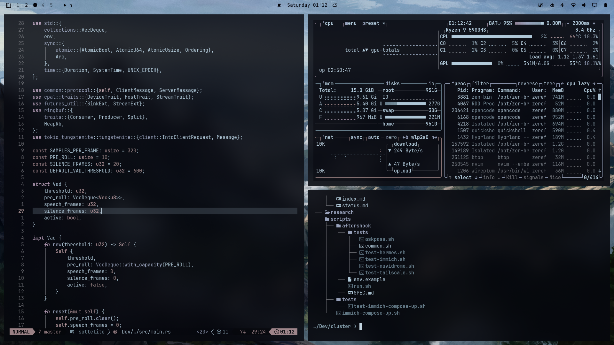

# Omarchy Neptune Theme

A cool, dark theme for [Omarchy](https://omarchy.org), built around pale blue
foregrounds over a near-black background, with muted blue accents and soft
magenta tones.



## Wallpapers

Four wallpapers included with the theme. Click any one for the full image.

<table>
<tr>
<td width="50%" align="center"><a href="backgrounds/jap-water.png"></a></td>
<td width="50%" align="center"><a href="backgrounds/mountains.jpg"></a></td>
</tr>
<tr>
<td width="50%" align="center"><a href="backgrounds/wallhaven-lyje9y.png"></a></td>
<td width="50%" align="center"><a href="backgrounds/wallhaven-rq617q_2560x1440.png"></a></td>
</tr>
</table>

## Install

```bash
omarchy theme install https://github.com/ishansing/neptune-omarchy
```

## Palette

| Role | Hex |
| --- | --- |
| Background | `#05060d` |
| Dark background | `#04050a` |
| Darker background | `#030307` |
| Lighter background | `#1e1f25` |
| Foreground | `#b6cfdf` |
| Accent | `#9aa4be` |
| Selection | `#b6cfdf` |
| Selection foreground | `#05060d` |
| Muted | `#65666c` |

Full ANSI palette in [`colors.toml`](colors.toml). Icons are `Yaru-magenta`.
